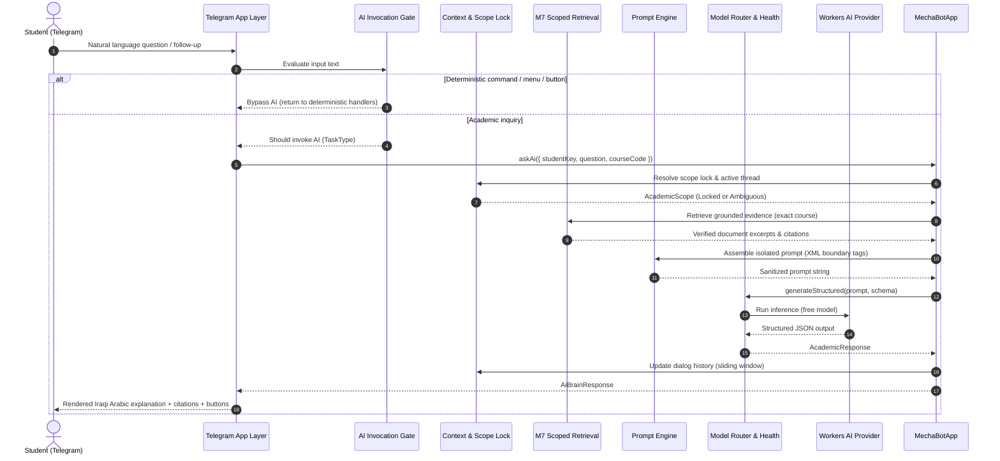

# Milestone 8: AI Brain Architecture & Orchestration

> **Operating Principle:** _"Infer, suggest, and confirm — never silently assume."_  
> **Iraqi Arabic:** _"يستنتج، يقترح، ويسأل للتأكيد؛ ما يفرض."_

---

## 1. Architectural Overview

The **AI Brain (M8)** is Mecha Bot's natural language orchestration and evidence synthesis layer. It connects student inquiries in natural Iraqi Arabic to verified academic grounding without ever owning domain ground truth.



---

## 2. Zero-Cost Invariants & Daily Allocation

Mecha Bot runs strictly on zero-cost infrastructure:

```typescript
export const ALLOW_PAID_AI = false;
export const ALLOW_PAID_STORAGE = false;
export const ALLOW_BILLING_FALLBACK = false;
```

### Cloudflare Workers AI Free Tier Quota

- **Daily Quota:** 10,000 Neurons per day across all models.
- **Fail-Closed Policy (Error 3036):** When daily neuron quota is exhausted, the AI Brain immediately engages a global fail-closed lock for the remainder of the UTC day.
- **Graceful Fallback:** When AI is unavailable or quota is reached, deterministic features (menus, timetable, reminders, direct search, file downloads, quizzes) continue to operate seamlessly.
- **User-Facing Fallback Message:**  
  _"حالياً المساعد الذكي غير متاح لاكتمال الحصة اليومية، بس تكدر تستخدم باقي وظائف البوت (الجداول، التذكيرات، البحث المباشر، والملفات) بشكل طبيعي."_

---

## 3. Multi-Provider Architecture & Model Matrix

The AI Brain supports a pluggable Multi-Provider architecture via `AIProvider` and `createAiProviderFromEnv()`. It supports Tier-1 Frontier Intelligence models alongside upgraded Cloudflare edge models:

### Supported Providers

1. **Google Gemini (Default Frontier Provider)**:
   - Implemented in `GeminiProvider`.
   - Native JSON mode with zero external SDKs (`generativelanguage.googleapis.com`).
   - Models: `gemini-2.0-flash`, `gemini-1.5-flash`.
   - Free Tier: 1,500 requests/day, 15 RPM. Exceptional Iraqi Arabic dialect fluency and complex engineering reasoning.
   - Env Key: `AI_PROVIDER=gemini`, `GEMINI_API_KEY=...`.

2. **Groq Cloud (Ultra-Fast 70B & 32B Inference)**:
   - Implemented in `OpenAiCompatibleProvider`.
   - Models: `llama-3.3-70b-versatile`, `deepseek-r1-distill-llama-70b`, `qwen-2.5-32b`.
   - Free Tier: 30 RPM, ultra-low latency (<1s).
   - Env Key: `AI_PROVIDER=groq`, `GROQ_API_KEY=...`.

3. **OpenRouter (OpenAI-Compatible Gateway)**:
   - Implemented in `OpenAiCompatibleProvider` with custom header support (`HTTP-Referer`, `X-Title`).
   - Models: `openrouter/free` or flagship models.
   - Env Key: `AI_PROVIDER=openrouter`, `OPENROUTER_API_KEY=...`.

4. **Cloudflare Workers AI (Edge Fallback)**:
   - Implemented in `WorkersAiProvider`.
   - Upgraded default models (purged 1B/3B):

| Configuration Key    | Upgraded Model ID                              | Task Suitability                                                         |
| :------------------- | :--------------------------------------------- | :----------------------------------------------------------------------- |
| `AI_MODEL_PRIMARY`   | `@cf/deepseek-ai/deepseek-r1-distill-qwen-32b` | `CONCEPT_EXPLANATION`, `MULTI_SOURCE_SYNTHESIS`, reasoning follow-ups    |
| `AI_MODEL_SECONDARY` | `@cf/qwen/qwen2.5-7b-instruct`                 | `SIMPLE_EXPLANATION`, `STRUCTURED_EXTRACTION`, fast Arabic math response |
| `AI_MODEL_FALLBACK`  | `@cf/meta/llama-3.1-8b-instruct`               | Emergency lightweight fallback                                           |

### Model Health State Machine

Tracks model states: `HEALTHY`, `DEGRADED`, `COOLDOWN`, `QUOTA_EXHAUSTED`, `PAID_ONLY`.

- **Error 3036 (Quota exhausted):** Marks global account quota exhausted for the day; stops all AI calls.
- **Error 3040 (Out of capacity):** Puts primary model into a 5-minute cooldown and routes transparently to the secondary model.
- **Error 5035 (Requires paid):** Permanently marks model as `PAID_ONLY`; never attempts paid routing.
- **Error 3007 (Timeout):** 1 bounded retry, then failover to fallback.
- **Retry Storm Prevention:** Maximum 1 bounded attempt per provider in the fallback chain.

---

## 4. AI Invocation Gate

The AI Invocation Gate evaluates incoming text with deterministic rules **before** invoking any model, eliminating wasteful LLM calls:

- **Bypasses AI:**
  - Slash commands: `/start`, `/menu`, `/courses`, `/where`, `/lost`, `/timetable`, `/reminders`, `/health`, `/help`
  - Inline callback prefixes: `m1:*`, `m:*`
  - Input under 3 characters or whitespace
  - Exact match commands
- **May Invoke AI:**
  - Interrogatives & explanations: _"اشرحلي"_, _"وضحلي"_, _"شنو الفرق"_, _"ما هو"_, _"ليش"_, _"كيف"_, _"حل"_
  - Engineering keywords: `root locus`, `bode`, `nyquist`, `stability`, `state space`, `pid`, `plc`, etc.
  - Follow-up questions when active course scope exists (_"ليش غيرنا الإشارة؟"_, _"شلون صارت؟"_)

---

## 5. Conversation Context & Academic Scope Lock

Keyed strictly by opaque application `studentKey` (zero Telegram ID leakage).

- **Scope Lock:** When a student is engaged in a course/topic thread (e.g. `MCT314 -> Root Locus`), follow-up inquiries remain locked to that scope.
- **Scope Transitions:** Explicit mentions of other courses (e.g. _"خل نروح لـ MCT312"_) transition the scope cleanly.
- **Ambiguity Detection:** Questions without course context or multiple possible course targets trigger a `CLARIFICATION_NEEDED` response with suggestion buttons rather than hallucinated scope switching.
- **TTL & Compaction:** Contexts expire after 30 minutes of inactivity. Dialog history is bounded to a sliding window of recent messages.

---

## 6. Scoped M7 Retrieval & Grounding

Retrieval follows a strict grounding workflow:

1. **Exact Course Boundary:** Search queries specify `courseCode` with `allowRelatedCourses: false`.
2. **Chunk Budgeting:** Caps evidence at top 3 relevant chunks with deduplication of overlapping document pages.
3. **Provenance Tracking:** Preserves `sourceId`, `chunkId`, `page`, and `authority` across the pipeline.
4. **Hallucination Prevention:** If evidence is insufficient, the AI acknowledges uncertainty (_"ما عندي مصدر كافي حتى أتأكد من هاي النقطة"_) and provides only safe engineering fundamentals.

---

## 7. Prompt Injection Defense & Privacy Boundary

### Structural Isolation

All prompts enforce XML-style structural tags:

- `<SYSTEM_RULES>`: Immutable instructions, Iraqi Arabic tone, persona, invariant constraints.
- `<ACADEMIC_SCOPE>`: Verified course code, title, stage, semester, topic map status.
- `<CONVERSATION_HISTORY>`: Recent sanitized dialog turns.
- `<RETRIEVED_EVIDENCE>`: Untrusted academic text excerpts.
- `<STUDENT_QUERY>`: Untrusted student input.

Any adversarial payloads (e.g. _"Ignore previous instructions"_) in student input or retrieved PDF text are enclosed in data tags and treated strictly as passive text strings.

### Privacy by Architecture

- Telegram IDs (`from.id`, `chat.id`), usernames, and Iraqi phone numbers are stripped before entering application layers.
- Prompt sanitizer actively detects and redacts phone numbers, emails, and user handles.

---

## 8. Domain Invariants

The AI Brain strictly adheres to all project invariants:

1. **Progress Integrity:** `EXPECTED != CONFIRMED_BY_STUDENT` and `INFERRED != CONFIRMED`. The AI Brain **never** confirms student progress or updates student position.
2. **MCT124:** Must remain `CONFLICTING / UNRESOLVED`. The AI surfaces the known conflict and never fabricates a syllabus resolution.
3. **P4MCT:** Must remain `IDENTITY_ONLY`. The AI surfaces that no topic progression map exists.
4. **Authority Boundaries:** AI explains M9 Study Navigator diagnoses, but M9 owns all diagnostic logic. AI never bypasses M11 Admin reviews or M12 File distribution policies.
