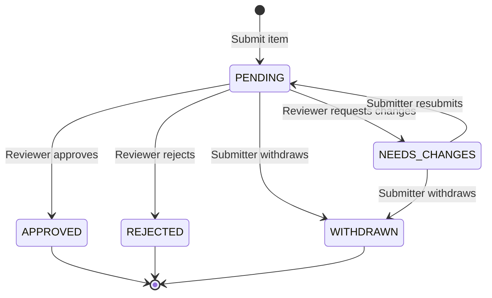

# Milestone M11A — Admin, Course Editor & Review Workflow Foundation

## Overview

Milestone M11A establishes the deterministic authorization, course-scoped administration, and content moderation pipeline foundation for Mecha Bot.

This package (`@mecha-bot/admin`) contains **domain logic only**. It deliberately contains:

- **NO** Telegram admin commands or UI buttons.
- **NO** database migrations or SQL schema changes.
- **NO** real user identifiers or Telegram IDs.
- **NO** AI or LLM dependencies.
- **NO** web dashboard.

---

## Architectural Principles

1. **Synthetic Actor Keys**: All administrative logic operates on opaque internal actor identifiers (`actorKey: string`, e.g., `actor_admin_1`, `actor_editor_1`). Mapping Telegram IDs or user records to internal actor keys is the responsibility of future integration layers.
2. **Capability-Based Permissions**: Permissions represent explicit, fine-grained capabilities (e.g., `COURSE_PULSE_UPDATE`, `TIMETABLE_UPDATE`, `SOURCE_APPROVE`) rather than hardcoded `if (role === 'admin')` checks across the codebase.
3. **Course Scoping Isolation**: Course editors are strictly constrained to their authorized course codes (e.g., `MCT314`). They cannot view or modify unassigned courses outside their assigned scope.
4. **Editor Assignment != Lecturer Assignment**: In Mecha Bot, a `CourseEditorAssignment` models:
   > _"This person is authorized to edit or update course data within Mecha Bot."_  
   > It does **NOT** denote lecturer status, instructional assignment, or teaching appointment.
5. **No Student Content Automatically Trusted**: Any content submitted by students (notes, summaries, timetable suggestions, exam updates) is initially routed to the moderation pipeline in a `PENDING` review state.
6. **Academic Evidence Demarcation**: An `APPROVED` status within the review workflow indicates solely that the item passed moderation. It **does NOT** automatically confer official academic evidence levels (`OFFICIAL_DEPARTMENT`, `EXACT_COURSE`, `VERIFIED_SOLUTION`), which belong strictly to academic and source authority domains.
7. **Comprehensive Auditability**: All privileged operations and authorization denials are captured as auditable events with minimal, privacy-preserving metadata (secrets and full message contents are strictly excluded).

---

## Role Model & Hierarchy

The system defines 5 primary roles:

| Role            | Hierarchy Rank | Purpose                                                                                                                | Scope                 |
| :-------------- | :------------: | :--------------------------------------------------------------------------------------------------------------------- | :-------------------- |
| `SUPER_ADMIN`   |       5        | Unrestricted system administrative control, role assignment, and emergency oversight.                                  | Global                |
| `ADMIN`         |       4        | Broad operational management, source review, course content management, and role delegation (with privilege ceilings). | Global                |
| `COURSE_EDITOR` |       3        | Scoped course management (Course Pulse, timetable updates, event creation) for explicitly assigned courses.            | Course-Scoped         |
| `REVIEWER`      |       3        | Verification and moderation of submitted academic materials, summaries, and student contributions.                     | Functional / Pipeline |
| `STUDENT`       |       1        | Default baseline role: read-only access to published curriculum/schedules and submission rights into moderation.       | Consumer              |

---

## Capability Permissions

All authorization checks evaluate specific capabilities:

- `ADMIN_MANAGE`: Configure system-wide administrative settings and inspect operations.
- `ROLE_ASSIGN`: Assign or revoke roles to actors (strictly bound by escalation policies).
- `COURSE_VIEW`: Read course syllabus, offerings, and basic course metadata.
- `COURSE_EDIT`: Modify course description, syllabus topics, and reference materials.
- `COURSE_PULSE_UPDATE`: Update current academic progress, weekly topics, and urgent notices for a course.
- `SOURCE_SUBMIT`: Submit academic notes, solutions, or documents into moderation.
- `SOURCE_REVIEW`: Inspect, evaluate, and request changes on student submissions.
- `SOURCE_APPROVE`: Approve submissions for inclusion in academic repositories.
- `ACADEMIC_EVENT_CREATE`: Schedule or announce course events (midterms, quizzes, seminars).
- `ACADEMIC_EVENT_REVIEW`: Moderate proposed academic events or exam dates.
- `TIMETABLE_UPDATE`: Adjust schedule slots, class locations, and timing.
- `QUIZ_MANAGE`: Create, manage, or moderate quiz question banks.
- `AUDIT_VIEW`: Access and filter audit event logs.

### Role Capability Matrix

| Capability              | `SUPER_ADMIN` |        `ADMIN`        |       `COURSE_EDITOR`       | `REVIEWER` | `STUDENT` |
| :---------------------- | :-----------: | :-------------------: | :-------------------------: | :--------: | :-------: |
| `ADMIN_MANAGE`          |      ✅       |          ✅           |             ❌              |     ❌     |    ❌     |
| `ROLE_ASSIGN`           |      ✅       | ✅ _(Policy guarded)_ |             ❌              |     ❌     |    ❌     |
| `COURSE_VIEW`           |      ✅       |          ✅           |             ✅              |     ✅     |    ✅     |
| `COURSE_EDIT`           |      ✅       |          ✅           | ✅ _(Assigned course only)_ |     ❌     |    ❌     |
| `COURSE_PULSE_UPDATE`   |      ✅       |          ✅           | ✅ _(Assigned course only)_ |     ❌     |    ❌     |
| `SOURCE_SUBMIT`         |      ✅       |          ✅           |             ✅              |     ✅     |    ✅     |
| `SOURCE_REVIEW`         |      ✅       |          ✅           |             ❌              |     ✅     |    ❌     |
| `SOURCE_APPROVE`        |      ✅       |          ✅           |             ❌              |     ✅     |    ❌     |
| `ACADEMIC_EVENT_CREATE` |      ✅       |          ✅           | ✅ _(Assigned course only)_ |     ❌     |    ❌     |
| `ACADEMIC_EVENT_REVIEW` |      ✅       |          ✅           |             ❌              |     ✅     |    ❌     |
| `TIMETABLE_UPDATE`      |      ✅       |          ✅           | ✅ _(Assigned course only)_ |     ❌     |    ❌     |
| `QUIZ_MANAGE`           |      ✅       |          ✅           |             ❌              |     ❌     |    ❌     |
| `AUDIT_VIEW`            |      ✅       |          ✅           |             ❌              |     ✅     |    ❌     |

---

## Course Scoping & Editor Assignments

Course editors are authorized to manage courses only through explicit, time-bounded assignments:

```typescript
interface CourseEditorAssignment {
  id: string;
  actorKey: string;
  courseCode: string; // e.g., "MCT314"
  permissions?: AdminPermission[]; // Optional capability subset
  validFrom?: string; // ISO 8601 string
  validTo?: string; // ISO 8601 string
  assignedBy: string; // actorKey
  assignedAt: string; // ISO 8601 string
  status: 'ACTIVE' | 'REVOKED' | 'EXPIRED';
  revokedAt?: string;
  revokedBy?: string;
  revocationReason?: string;
}
```

### Authorization Evaluation Rules for Course Editors:

1. When a course editor requests an action requiring `COURSE_SCOPED_PERMISSIONS` (`COURSE_EDIT`, `COURSE_PULSE_UPDATE`, `TIMETABLE_UPDATE`, `ACADEMIC_EVENT_CREATE`), a target `courseCode` must be provided in the resource descriptor.
2. If no assignment matches the normalized course code: decision is `DENIED` with reason `OUT_OF_SCOPE`.
3. If the matching assignment has status `REVOKED`: decision is `DENIED` with reason `ASSIGNMENT_REVOKED`.
4. If the assignment is expired (`status === 'EXPIRED'` or `validTo < now`): decision is `DENIED` with reason `ASSIGNMENT_EXPIRED`.
5. If `validFrom > now`: decision is `DENIED` with reason `ASSIGNMENT_NOT_YET_EFFECTIVE`.
6. If the assignment defines a custom permissions subset that excludes the requested permission: decision is `DENIED` with reason `PERMISSION_NOT_IN_ASSIGNMENT`.

---

## Privilege Escalation Protections

The system deterministically prevents unauthorized privilege acquisition:

1. **Self-Escalation Prevention**:
   An actor cannot assign or elevate their own role (`callerKey === targetActorKey` is blocked and audited).
2. **Privilege Ceiling**:
   - `ADMIN` cannot grant `SUPER_ADMIN`.
   - `ADMIN` cannot demote or revoke `SUPER_ADMIN`.
   - Only `SUPER_ADMIN` can grant or revoke `SUPER_ADMIN`.
   - `COURSE_EDITOR`, `REVIEWER`, and `STUDENT` cannot assign or revoke any roles.
3. **Last Super Admin Safeguard**:
   The domain logic enforces that the last remaining `SUPER_ADMIN` in the system cannot be demoted or revoked (`countSuperAdmins() <= 1` check).

---

## Moderation & Review Workflow

All student-submitted contributions follow an explicit state machine:



### Self-Review Policy

- **Default Rule**: An actor cannot review or approve their own submission (`reviewerKey === submitterKey` is rejected with `SELF_REVIEW_FORBIDDEN_INDEPENDENT_REVIEW_REQUIRED`).
- **Super Admin Emergency Override**: A `SUPER_ADMIN` may approve their own submission only when `allowSuperAdminOverride: true` is explicitly provided. This override is permanently recorded in the audit trail with `isSuperAdminOverride: true`.

### Explicit Reopening

Direct status transitions from `APPROVED -> PENDING` or `REJECTED -> PENDING` are prohibited. Reopening is modeled as an explicit administrative operation (`reopenReviewItem`), requiring `ADMIN_MANAGE` capability and full audit logging.

---

## Audit Trail Model

All security-sensitive actions and authorization denials are logged via `AdminAuditEvent`:

```typescript
interface AdminAuditEvent {
  id: string; // Deterministic sequential identifier
  actorKey: string;
  action: string;
  resourceType: string;
  resourceKey?: string;
  courseCode?: string;
  outcome: 'ALLOWED' | 'DENIED' | 'SUCCESS' | 'FAILURE';
  reason?: string;
  timestamp: string; // ISO 8601
  metadata?: Record<string, unknown>;
}
```

### Privacy & Data Sanitization Rules:

- **Redaction of Secrets**: Any metadata key matching `/password|secret|token|credential|apikey|auth|private/i` is automatically masked to `"[REDACTED]"`.
- **Payload Truncation**: Strings exceeding 200 characters are truncated with `"...[TRUNCATED]"` to prevent storing raw documents or unbounded message payloads in audit logs.

---

## Integration Touchpoints (Future Milestones)

| Domain               | Milestone | Future Integration Role                                                                                                                                       |
| :------------------- | :-------: | :------------------------------------------------------------------------------------------------------------------------------------------------------------ |
| **Academic Core**    |    M2     | Connect course editor permissions to edit `CourseProfile` descriptions and syllabus topics.                                                                   |
| **Timetable**        |    M3     | Restrict timetable slot creation/adjustment to actors authorized with `TIMETABLE_UPDATE`.                                                                     |
| **Source Ingestion** |    M6     | Route ingested student PDFs and lecture notes into the `ReviewItem` moderation workflow before publication.                                                   |
| **Exams & Quizzes**  |    M10    | Validate `ACADEMIC_EVENT_CREATE` and `QUIZ_MANAGE` permissions before scheduling exam dates or publishing quiz sets.                                          |
| **Database**         | Post-M11  | Map `InMemoryAdminRepository` interfaces to SQLite / Cloudflare D1 tables (`admin_roles`, `course_editor_assignments`, `review_items`, `admin_audit_events`). |
| **Telegram Bot**     |   M11B+   | Implement admin command handlers (`/admin`, `/review`, `/assign`) mapping Telegram `userId` to `actorKey`.                                                    |
