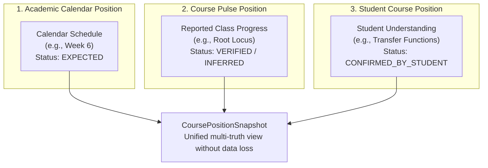
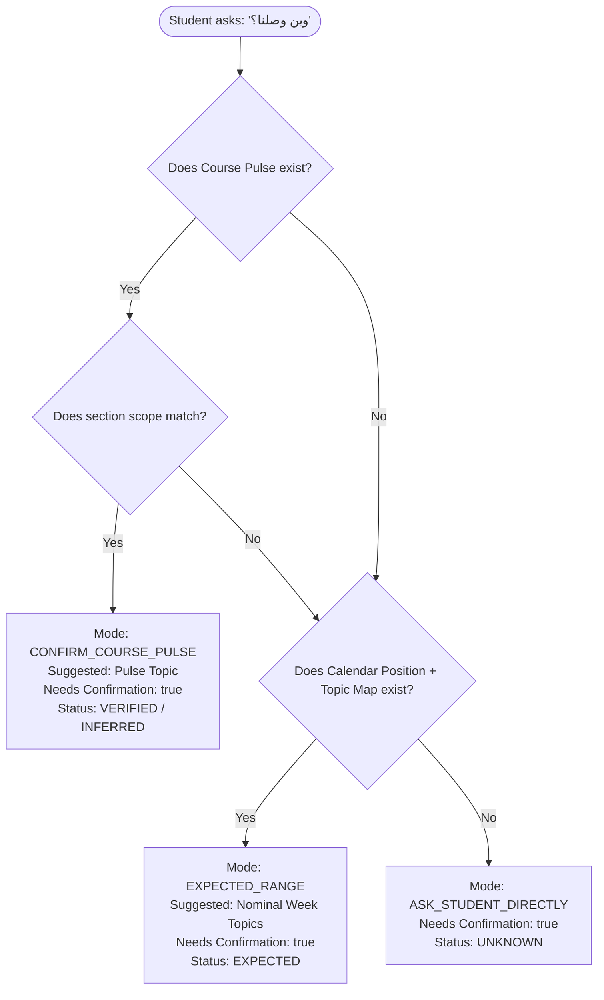
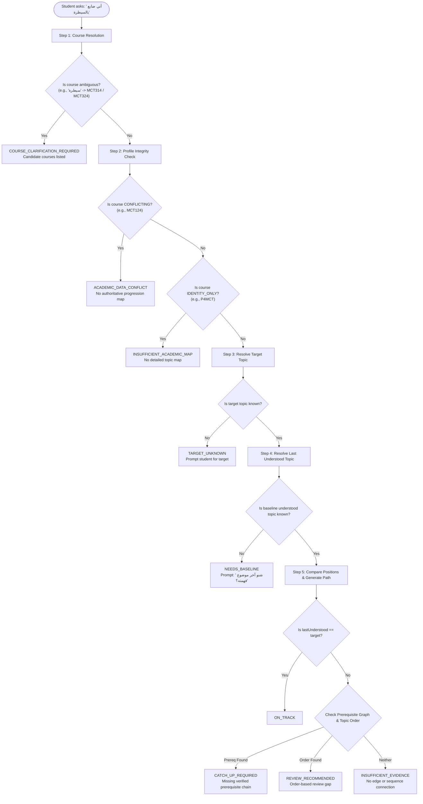
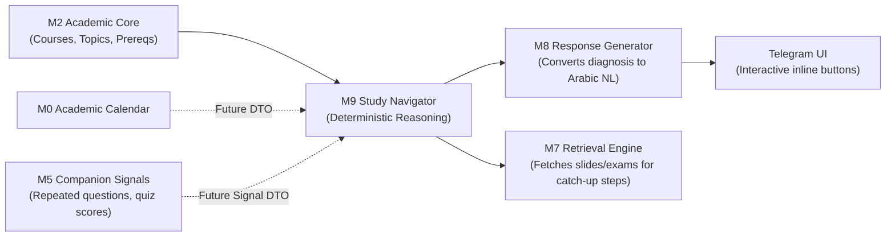

# Milestone M9A — Study Navigator & Catch-Up Foundation

## Executive Summary

The Study Navigator (`@mecha-bot/navigator`) provides the deterministic reasoning foundation for Mecha Bot's academic guidance and diagnostic queries, including:

- _"أني ضايع"_ (I am lost)
- _"ما فاهم Root Locus"_ (I don't understand Root Locus)
- _"اني فاهم transfer function بس بعدها ضعت"_ (I understood transfer functions but got lost after that)
- _"وين المفروض أراجع؟"_ (Where should I review?)
- _"شنو ناقصني حتى أفهم هذا الموضوع؟"_ (What prerequisite am I missing to understand this topic?)
- _"وين وصلنا؟"_ (Where are we in the course?)

Crucially, this foundation does **NOT** use generative AI, Large Language Models (LLMs), embeddings, or probabilistic guessing. It operates via deterministic graph traversal over the verified curriculum and syllabus data delivered in Milestone M2, honoring the core principle:
$$\text{infer} \longrightarrow \text{suggest} \longrightarrow \text{confirm}$$
The system **never silently assumes** student mastery or class progress.

---

## 1. Important Truth Separation (The Three Positions)

A central architectural requirement is maintaining three distinct representations of academic progression. These truths must **never** be collapsed into a single status or overwritten by one another:

### Truth 1: Academic Calendar Position

- **What it represents**: Where the institutional academic semester schedule projects the class to be based on nominal calendar weeks (e.g., _"Week 6"_).
- **Status**: Always `EXPECTED`.
- **Source**: `ACADEMIC_CALENDAR`.
- **Rule**: `EXPECTED` is purely nominal. It can never be promoted to `CONFIRMED_BY_STUDENT` or `VERIFIED` without explicit external evidence.

### Truth 2: Course Pulse Position

- **What it represents**: Where the instructor or class cohort is reported to have actually reached in the lecture hall (e.g., _"Root Locus"_).
- **Status**:
  - `VERIFIED`: Confirmed by an authorized course editor, department instructor, or class representative.
  - `INFERRED`: Derived from peer reports, recent student questions, or historical telemetry.
- **Source**: `COURSE_EDITOR`, `STUDENT`, or `SYSTEM_INFERENCE`.
- **Scope**: Supports `GLOBAL` or section-specific (`SECTION_A`, `SECTION_B`) pulses.
- **Rule**: `INFERRED` cannot be promoted to `VERIFIED` by system inference alone.

### Truth 3: Student Course Position

- **What it represents**: What this specific student understands, attended, or is currently studying (e.g., `lastUnderstoodTopicKey = 'mct314-transfer-function-modeling'`).
- **Status**: `CONFIRMED_BY_STUDENT`.
- **Source**: `STUDENT`.
- **Rule**: Independent of class pulse. A student stating _"احنا بعدنا قبلها"_ (we are still before that topic) updates their personal `StudentCoursePosition` without mutating the cohort's global `CoursePulsePosition`.

---

## 2. "وين وصلنا؟" (Where Are We?) Decision Engine

The progress evaluation engine (`evaluateCourseProgress`) determines the class's current topic using a strict precedence waterfall:

### Case A: Course Pulse Exists

- **Verified Pulse**: Returns mode `CONFIRM_COURSE_PULSE` with `evidenceStatus: 'VERIFIED'` and prompt key `CONFIRM_VERIFIED_PULSE`.
  - _Future Telegram UX_: _"آخر تحديث من ممثل المادة يقول وصلتوا Root Locus، هذا فعلاً اللي أخذتوه؟"_ with buttons: [نعم] [قبلها] [بعدها].
- **Inferred Pulse**: Returns mode `CONFIRM_COURSE_PULSE` with `evidenceStatus: 'INFERRED'` and prompt key `CONFIRM_UNVERIFIED_PULSE`.

### Case B: Calendar Position Available

- When no verified pulse exists, but `academicWeek` is known and nominal topic maps are available:
- Returns mode `EXPECTED_RANGE` with `evidenceStatus: 'EXPECTED'`.
- Includes adjacent syllabus topics within $\pm 1$ nominal week.

### Case C: No Usable Evidence

- If neither pulse nor calendar map is available (e.g., unstructured courses or incomplete semester profiles):
- Returns mode `ASK_STUDENT_DIRECTLY` with `evidenceStatus: 'UNKNOWN'`.
- Never invents or hallucinates a topic.

---

## 3. "أني ضايع" (I Am Lost) Diagnosis Engine

The diagnostic engine (`diagnoseStudyPosition`) maps the student's learning state relative to target topics:

---

## 4. Topic Order vs. Prerequisite Graph Distinction

A fundamental safety invariant enforced by Milestone M9 is the strict separation between **Topic Order** (nominal sequence in syllabus) and **Prerequisites** (proven conceptual dependencies):

| Attribute            | Prerequisite Dependency                                                           | Topic Order Review                                                                    |
| :------------------- | :-------------------------------------------------------------------------------- | :------------------------------------------------------------------------------------ |
| **Data Source**      | `prerequisites.v1.json` (`PrerequisiteGraph`)                                     | `topic-maps/*.v1.json` (`orderIndex`, `nominalWeek`)                                  |
| **Meaning**          | Concept B mathematically/theoretically requires Concept A                         | Concept B was taught chronologically after Concept A                                  |
| **Reason Code**      | `DIRECT_PREREQUISITE` or `DEPENDENCY_CHAIN`                                       | `ORDER_BASED_REVIEW`                                                                  |
| **Diagnosis Status** | `CATCH_UP_REQUIRED`                                                               | `REVIEW_RECOMMENDED`                                                                  |
| **Graph Rule**       | Strict directed acyclic graph traversal                                           | Array index comparison within same course                                             |
| **Safety Invariant** | If no prerequisite edge exists, **never** synthesize one from syllabus week order | Intermediate topics are clearly marked as chronological review, not hard dependencies |

---

## 5. Catch-Up Plan & Short Study Budgets

When a gap is diagnosed, the navigator produces a deterministic, structured `CatchUpPlan`. No natural language prose is hallucinated.

### Step Ordering Rules:

1. Prerequisite foundational topics are ordered sequentially from root to target.
2. Zero duplicate topics.
3. The target topic appears exactly once at the final step (`reason: 'TARGET_TOPIC'`).

### Study Budget Partitioning (`partitionStudyBudget`)

To support real student constraints (_"عندي 10 دقايق"_, _"عندي نص ساعة"_), time is deterministically allocated across three review blocks, labeled `PLANNING_HEURISTIC`:

| Budget               | With Prerequisites                                                            | Target Topic Only                                |
| :------------------- | :---------------------------------------------------------------------------- | :----------------------------------------------- |
| **10 min**           | 5m Prerequisite Review + 5m Target Focus                                      | 8m Target Focus + 2m Self-Check                  |
| **15 min**           | 5m Prerequisite Review + 7m Target Focus + 3m Self-Check                      | 12m Target Focus + 3m Self-Check                 |
| **30 min**           | 10m Prerequisite Review + 15m Target Focus + 5m Self-Check                    | 22m Target Focus + 8m Self-Check                 |
| **45 min**           | 15m Prerequisite Review + 20m Target Focus + 10m Self-Check                   | 32m Target Focus + 13m Self-Check                |
| **60 min**           | 20m Prerequisite Review + 25m Target Focus + 15m Self-Check                   | 45m Target Focus + 15m Self-Check                |
| **Custom ($N$ min)** | $\approx 33\%$ Prerequisite, $\approx 50\%$ Target, $\approx 17\%$ Self-Check | $\approx 75\%$ Target, $\approx 25\%$ Self-Check |

**Validation Rule**: Non-positive durations ($\le 0$), floats, and `NaN` are strictly rejected with `ValidationError`.

---

## 6. Baseline Calibration for Mid-Semester Students

When a student joins Mecha Bot mid-semester or initiates diagnosis without previous records:

1. The navigator identifies that `lastUnderstoodTopicKey` is missing.
2. Returns status `NEEDS_BASELINE`.
3. Prompts the student: _"شنو آخر موضوع تتذكر أنك فاهمه بالمادة؟"_
4. Resolves the answer via M2 `TopicResolver`.
5. If ambiguous or unrecognized (e.g., _"البطيخة"_), returns `TOPIC_CLARIFICATION_REQUIRED` without fabricating a match.
6. Once confirmed, stores the calibrated position in `StudentCoursePositionRepository`.

---

## 7. Course Contradiction & Fallback Safety

### MCT124 Contradiction Safety

As documented in Milestone M2, `MCT124` (Electrical Technology & Circuits Lab) features direct contradictions between the weekly program matrix and the department course description form.

- The navigator inspects `profile.topicMapStatus`.
- If `CONFLICTING`, diagnosis immediately yields `ACADEMIC_DATA_CONFLICT` with reason codes `['ACADEMIC_DATA_CONFLICT', 'MCT124_CONFLICT']`.
- The system will **never** pretend to have an authoritative sequence for conflicting data.

### P4MCT Identity-Only Safety

Final-year graduation project `P4MCT` has no fixed weekly topic syllabus (`IDENTITY_ONLY`).

- Diagnosis safely returns `INSUFFICIENT_ACADEMIC_MAP` with reason code `['IDENTITY_ONLY_COURSE']`.
- Prevents runtime errors or attempts to traverse empty topic graphs.

---

## 8. Integration Architecture with Future Milestones

1. **Future M5 (Companion / Learning Signals)**:
   - M9 defines `StudentLearningSignal` (e.g., `REPEATED_QUESTION`, `SELF_REPORTED_DIFFICULTY`).
   - M5 can pass these signals to M9 to influence suggested review topics without violating the rule against automatic mastery assumptions.
2. **Future M7 (Source Retrieval)**:
   - When a `CatchUpPlan` produces steps $T_1 \to T_2 \to T_3$, M7 can retrieve lecture PDFs, past exams, and formula sheets specifically keyed to those topic keys.
3. **Future M8 (Language Generation & Arabic Persona)**:
   - M9 outputs structured diagnostics (`StudyDiagnosis`, `CatchUpPlan`).
   - M8 translates these structured objects into natural, encouraging Basrah-dialect Arabic explanations.
4. **Future Telegram UI**:
   - Inline keyboard confirmation buttons (_"نعم"_, _"قبلها"_, _"بعدها"_) will trigger navigator confirmation handlers to transition state from `EXPECTED`/`INFERRED` to `CONFIRMED_BY_STUDENT`.
