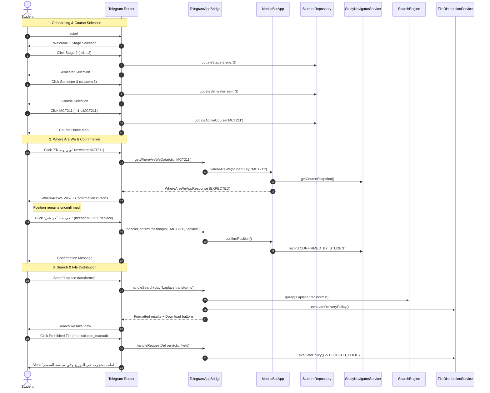

# Telegram Application Layer & End-to-End Student Flows

## 1. Architectural Architecture & Hexagonal Boundary

Mecha Bot implements a strict **hexagonal architecture** separating the Telegram presentation layer from application orchestration, domain truth, and persistent storage.

```
       ┌──────────────────────────────────────────────────────────┐
       │                Telegram Presentation Layer               │
       │                   (@mecha-bot/telegram)                  │
       │                                                          │
       │   bot.ts (Commands & Middleware)                         │
       │     └─ router.ts (Event Routing & Session State)         │
       │          ├─ keyboards.ts (InlineKeyboard builders)       │
       │          └─ views.ts (Iraqi Arabic presentation only)    │
       └────────────────────────────┬─────────────────────────────┘
                                    │ (grammY Context mapped to studentKey)
                                    ▼
       ┌──────────────────────────────────────────────────────────┐
       │             Application & Wiring Layer                   │
       │                (@mecha-bot/wiring)                       │
       │                                                          │
       │   TelegramAppBridge (Adapter for student identity)       │
       │   MechaBotApp (Cross-domain use-case orchestrator)       │
       └────────────────────────────┬─────────────────────────────┘
                                    │
                                    ▼
       ┌──────────────────────────────────────────────────────────┐
       │              Domain Services (M1–M12)                    │
       │                                                          │
       │   - Academic Core (M2)       - Study Navigator (M9)      │
       │   - Timetable (M3)           - Exams & Quizzes (M10)     │
       │   - Scheduler (M4)           - File Distribution (M12)   │
       │   - Companion (M5)           - Search Engine (M7)        │
       └────────────────────────────┬─────────────────────────────┘
                                    │
                                    ▼
       ┌──────────────────────────────────────────────────────────┐
       │               Persistence & Repositories                 │
       │                 (@mecha-bot/database)                    │
       │                                                          │
       │   - StudentRepository (SQLite / Cloudflare D1)           │
       │   - AcademicRepository                                   │
       │   - In-memory domain repositories for zero-cost harness  │
       └──────────────────────────────────────────────────────────┘
```

### Boundary Isolation Invariants

1. **Zero grammY Leakage**:
   - Types like `Context`, `InlineKeyboard`, and Telegram update objects NEVER cross into `@mecha-bot/wiring`, `@mecha-bot/academic`, `@mecha-bot/navigator`, or any other domain package.
2. **Identity Translation at the Boundary**:
   - External Telegram numerical user IDs (`ctx.from.id`) are resolved exclusively at the boundary via `StudentRepository.findByTelegramId(telegramUserId)`.
   - Domain and application services only receive an opaque internal `studentKey` (e.g. `student_<uuid>` or `student_<id>`).
3. **Thin Handlers**:
   - `router.ts`: Dispatches events, parses callback payloads, and manages transient interaction state (`TelegramUserSession`).
   - `views.ts`: Pure presentation functions returning formatted markdown strings in natural Iraqi Arabic. No domain decisions or DB calls.
   - `keyboards.ts`: Pure builders for `InlineKeyboard`.
   - `TelegramAppBridge`: Thin bridge translating Telegram context to domain queries.

---

## 2. Separation of Responsibilities

| Layer                         | Component                                     | Primary Responsibility                                                                                                             |
| ----------------------------- | --------------------------------------------- | ---------------------------------------------------------------------------------------------------------------------------------- |
| **Telegram Router**           | `OnboardingRouter` (`router.ts`)              | Command routing, callback query matching, text query ingestion, session lifecycle (`TelegramUserSession`).                         |
| **Telegram Views**            | `views.ts`                                    | Rendering Iraqi Arabic user interfaces for all student menus, whereAreWe cases, search results, timetable, reminders, and quizzes. |
| **Telegram Keyboards**        | `keyboards.ts`                                | Pure inline button builders with compact, stable callback tokens (`m1:*`, `m:*`).                                                  |
| **Application Adapter**       | `TelegramAppBridge` (`application-bridge.ts`) | Context-to-studentKey resolution and invocation of `MechaBotApp` use cases.                                                        |
| **Application Orchestration** | `MechaBotApp` (`orchestrator.ts`)             | Cross-domain workflows (e.g. `whereAreWe`, `imLost`, `search`, `requestDelivery`, `scheduleLectureReminders`).                     |
| **Domain Services**           | M1–M12 Packages                               | Domain rules, prerequisite trees, timetable logic, search indexing, distribution policies, and quiz scoring.                       |
| **Persistence**               | `@mecha-bot/database`                         | SQLite / Cloudflare D1 migrations, student profiles, academic catalog, calendar periods.                                           |

---

## 3. "وين وصلنا؟" (Where Are We) Semantics & 3 Truths

The core product safety principle of Mecha Bot is:

> **"يستنتج، يقترح، ويسأل للتأكيد؛ ما يفرض"**  
> _(Infer, suggest, and confirm — never silently assume)._

The application strictly tracks **three separate truths** for every course:

1. **Calendar Position (`EXPECTED`)**:
   - Computed from the official academic calendar period and nominal week count.
   - Always marked as `EXPECTED`.
2. **Course Pulse Position (`VERIFIED` or `INFERRED`)**:
   - Derived from class progress signals, peer study logs, or lecturer updates.
   - Represents the estimated class pace, NEVER the individual student's confirmed pace.
3. **Student Position (`CONFIRMED_BY_STUDENT`)**:
   - Created **ONLY** when a student clicks explicit confirmation (`m:conf:<courseCode>:<topicKey>`).
   - Browsing "وين وصلنا؟", declining confirmation, or executing academic search NEVER silently mutates student position into confirmed state.

### Multi-Case Evaluation Workflow

- **Case A (Calendar Only)**:
  - No course pulse and no student confirmation.
  - Bot presents the calendar estimate and explicitly asks: _"وصلتوا فعلياً لهذا الموضوع بالدراسة؟"_.
- **Case B (Course Pulse)**:
  - Class progress signal exists.
  - Bot presents classroom evidence and asks: _"وصلتوا فعلياً لهذا الموضوع بالمحاضرات؟"_.
- **Case C (Confirmed Student Progress)**:
  - Displays the student's confirmed position alongside class pace.
- **Case D (Academic Conflict — MCT124)**:
  - Surfaced as `CONFLICTING` / `UNRESOLVED` without guessing or fabricating progression.
- **Case E (Identity-Only Course — P4MCT)**:
  - Surfaced as `IDENTITY_ONLY` with an explicit notice that no detailed syllabus breakdown exists.

---

## 4. End-to-End Student Flow Lifecycle



---

## 5. Architectural Invariant Certifications

| Invariant                        | Specification                                                                                    | Verification Test                                       |
| -------------------------------- | ------------------------------------------------------------------------------------------------ | ------------------------------------------------------- |
| **Zero Silent Confirmation**     | Inferred calendar or course pulse progress NEVER silently becomes student-confirmed progress.    | `tests/telegram-student-flows.test.ts` (Case I, Case F) |
| **Explicit Confirmation Gate**   | Only explicit click on `m:conf:<course>:<topic>` transitions position to `CONFIRMED_BY_STUDENT`. | `tests/telegram-student-flows.test.ts` (Case H)         |
| **MCT124 Conflict Safety**       | Curricular conflict remains `CONFLICTING` / `UNRESOLVED` without guessing.                       | `tests/telegram-student-flows.test.ts` (Case J)         |
| **P4MCT Identity-Only Safety**   | Identity-only course remains `IDENTITY_ONLY` without fabricated topics.                          | `tests/telegram-student-flows.test.ts` (Case K)         |
| **Distribution Policy Boundary** | Solution manuals and restricted files are blocked with `BLOCKED_POLICY`.                         | `tests/telegram-student-flows.test.ts` (Case O)         |
| **Iraq Timezone Compliance**     | All timetable slots and reminders operate in `Asia/Baghdad`.                                     | `tests/telegram-student-flows.test.ts` (Case P, Case Q) |
| **Deterministic Quiz Scoring**   | Quizzes score deterministically based on verified question option keys.                          | `tests/telegram-student-flows.test.ts` (Case S, Case T) |
| **Zero-Cost Architecture**       | Purely local SQLite and in-memory test harnesses (`ALLOW_PAID_AI=false`).                        | Full test suite (492 tests)                             |

---

## 6. Report of Real vs Planned APIs Adapted

In strict accordance with user directives, the real current repository implementation was preserved as the sole source of truth:

1. **Course Profile Display Names**:
   - _Plan Assumption_: `course.nameAr` / `course.nameEn`.
   - _Real API Used_: `course.displayNames.ar` and `course.displayNames.en` on `CourseProfile` from `@mecha-bot/academic`.
2. **Timetable Slot Lecturer Field**:
   - _Plan Assumption_: `slot.instructorName`.
   - _Real API Used_: `slot.lecturerDisplayName` on `TimetableSlot` from `@mecha-bot/timetable`.
3. **Student Position Attribute**:
   - _Plan Assumption_: `studentPos.topicKey`.
   - _Real API Used_: `studentPos.lastUnderstoodTopicKey` on `StudentCoursePosition` from `@mecha-bot/navigator`.
4. **Diagnosis Status Enums**:
   - _Plan Assumption_: `MISSING_BASELINE_POSITION` and `GAP_IDENTIFIED`.
   - _Real API Used_: `NEEDS_BASELINE`, `CATCH_UP_REQUIRED`, `REVIEW_RECOMMENDED`, and `ON_TRACK` from `@mecha-bot/navigator`.
5. **Exams Service Method Surface**:
   - _Plan Assumption_: `examsService.listQuizzes(courseCode)` and `examsService.listPastQuestions(...)`.
   - _Real API Used_: Reused real M10 contracts `examsService.listEvents(courseCode)` and `examsService.getQuiz(quizId)` without fabricating non-existent service methods.
6. **Practice Quiz Scoring Contract**:
   - _Plan Assumption_: Index-based answer array.
   - _Real API Used_: `QuizAnswers = Record<string, string | boolean>` mapped to `question.correctOptionId` (`opt_a`, etc.) adhering to `scoreQuiz` in `@mecha-bot/exams`.
7. **Student Repository Contract**:
   - _Plan Assumption_: `studentRepo.createOrUpdate(...)`.
   - _Real API Used_: `studentRepo.upsert(...)`, `studentRepo.findOrCreate(...)`, and `studentRepo.findByTelegramId(...)` from `@mecha-bot/database`.
